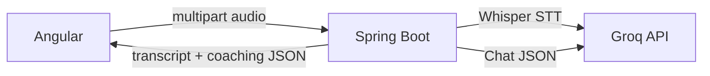

# Speak Better

Web app to **record** or **upload** audio/video (English or Hindi), **transcribe** with Groq Whisper, and get **rephrasings**, optional **Q&A coaching** (example answer + improvement tips), and **browser text-to-speech** for playback.

## Architecture

- **Angular 18** (`frontend/`) — `MediaRecorder`, file upload, `HttpClient` to the API, `speechSynthesis` for Play buttons.
- **Spring Boot 3** (`backend/`) — proxies media to Groq **Whisper** and structured JSON coaching to **Llama**, so your `GROQ_API_KEY` never ships to the browser.



## Prerequisites

- **Node.js 18+** and npm (for Angular).
- **Java 17+** and Maven (or use the Maven Wrapper if you add one).
- A **Groq API key** from [console.groq.com](https://console.groq.com).

## Setup

1. Export your API key (shell session):

   ```bash
   export GROQ_API_KEY=gsk_your_key_here
   ```

### Single port (recommended — like my-stock-checker / watchalong)

Build the Angular app into Spring Boot static resources, then run only the backend:

```bash
cd frontend && npm install && cd ..
./build.sh
cd backend && mvn -DskipTests spring-boot:run
```

Open **http://localhost:8080** — UI and `/api/*` on the same port. Static files live in [`backend/src/main/resources/static/`](backend/src/main/resources/static/) (generated; not committed except `.gitkeep`).

If the frontend was not built, `/` shows a short “Frontend not built” page with build instructions ([`WebMvcConfig.java`](backend/src/main/java/com/speakbetter/config/WebMvcConfig.java)).

### Dev split (optional)

For hot reload, run Angular and Spring Boot separately:

```bash
# terminal 1
cd backend && mvn spring-boot:run

# terminal 2
cd frontend && npm start
```

Open **http://localhost:4200** (proxies `/api` → `8080` via [`frontend/proxy.conf.json`](frontend/proxy.conf.json)). CORS allows `4200` for this mode.

4. Optionally paste a **question**, set **Response language (coaching)** (defaults to English), pick **speech hint** / **tone**, then **record** or **upload** a file.

## Configuration

| Variable / property | Purpose |
|---------------------|---------|
| `GROQ_API_KEY` | Groq bearer token (required) |
| `groq.base-url` | Default `https://api.groq.com/openai/v1` in [`backend/src/main/resources/application.yml`](backend/src/main/resources/application.yml) |
| `groq.stt-model` | Default `whisper-large-v3` |
| `groq.chat-model` | Default `openai/gpt-oss-120b` (best quality; low TPM on free tier — used for consultation structuring) |
| `groq.chat-model-fast` | Default `openai/gpt-oss-20b` (refine, summaries, practice coaching — separate TPM pool) |

## API

| Method | Path | Description |
|--------|------|-------------|
| `POST` | `/api/transcribe` | `multipart/form-data`: part `audio` (file), optional `language` (`en`, `hi`, or omit with Auto). Returns `{ text, language, textHindi, textEnglish }` — full utterance in Devanagari Hindi and English (via Whisper + LLM normalization). |
| `POST` | `/api/rephrase` | JSON `{ "text", "language"?, "tone"?, "question"?, "responseLanguage"? }` → coaching JSON. |
| `POST` | `/api/conversation/process` | `multipart/form-data`: part `audio`, optional `language`. Doctor–patient pipeline: Whisper → dialogue split + Hindi/English → **refinement pass** → bilingual clinical summaries. |

CORS is enabled for `http://localhost:4200`.

### Pages

- **`/`** — English practice (rephrasing + coaching)
- **`/speaking`** — AI Speaking Partner (live turn-taking POC)
- **`/consultation`** — Doctor–patient conversation transcript + summaries

### AI Speaking Partner (POC)

Real-time conversation for personal use. Conversation and coaching are **decoupled**: the AI replies first; corrections arrive asynchronously and are stored for later review.

| Layer | Free POC default | Swap how |
|-------|------------------|----------|
| STT | Browser Web Speech API (Chrome/Edge) | Frontend `SPEECH_TO_TEXT` token in `app.config.ts` |
| Conversation LLM | Groq (`speaking.conversation-provider=groq`) | New `ConversationEngine` bean + yaml |
| Coaching LLM | Groq (`speaking.coaching-provider=groq`) | New `CoachingEngine` bean + yaml |
| TTS | Browser `speechSynthesis` | Frontend `TEXT_TO_SPEECH` token |
| Session log | JSON files under `./data/speaking/` | `SpeakingSessionRepository` |

API:

| Method | Path | Role |
|--------|------|------|
| `GET` | `/api/speaking/providers` | Active provider IDs |
| `POST` | `/api/speaking/sessions` | Start session (`topic`, `mode`, `level`) |
| `POST` | `/api/speaking/sessions/{id}/turns` | Student text → AI reply (+ async coaching) |
| `GET` | `/api/speaking/sessions/{id}` | Full transcript, corrections, patterns |
| `GET` | `/api/speaking/sessions` | Past sessions (revise later) |
| `POST` | `/api/speaking/sessions/{id}/end` | End + short review summary |

Use **Chrome or Edge** for the mic. Typing always works as a fallback. Groq free tier is enough for light personal use; expect rate limits on long daily sessions (~2h/day may need a small paid plan later).

### Upload formats

Whisper accepts common containers (e.g. **WebM, MP3, WAV, M4A, MP4**). **MP4 must include an audio track**; silent or video-only files may fail transcription.

## Follow-up work

See [`ENHANCEMENTS.md`](ENHANCEMENTS.md) for optional features (waveform, analysis, translation, cloud TTS, history).

## License

MIT (or your choice — not set by this scaffold).
